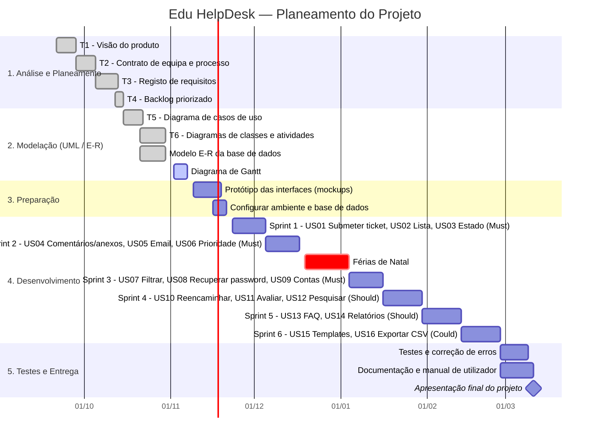

# 📅 Diagrama de Gantt — Edu HelpDesk

**Equipa EduHelp:** Pedro Fernandes e Rafael Silveira
**Disciplina:** Programação e Sistemas de Informação — 12.º Ano (Turma I-24-27)
**Ano letivo:** 2026/2027

O planeamento está dividido em 5 fases. As fases de **Análise** e **Modelação** correspondem às Tarefas 1 a 6 já entregues. O **Desenvolvimento** está organizado em *sprints* de 2 semanas, seguindo a prioridade MoSCoW do [Backlog Priorizado (Tarefa 4)](./Informações/Ficha%20M18-T4-Backlog%20priorizado.pdf): primeiro as *Must*, depois as *Should* e no fim as *Could*.

## Resumo das fases

| Fase | Período | Conteúdo | Estado |
| :--- | :--- | :--- | :--- |
| 1. Análise e Planeamento | 21/09 – 15/10/2026 | Tarefas 1 a 4 | ✅ Concluído |
| 2. Modelação | 15/10 – 06/11/2026 | Tarefas 5 e 6, E-R, Gantt | 🔄 A terminar |
| 3. Preparação | 09/11 – 20/11/2026 | Mockups, ambiente, base de dados | ⏳ Por fazer |
| 4. Desenvolvimento | 23/11/2026 – 26/02/2027 | 6 sprints com as 16 user stories | ⏳ Por fazer |
| 5. Testes e Entrega | 01/03 – 16/03/2027 | Testes, documentação, apresentação | ⏳ Por fazer |

## Distribuição das user stories por sprint

| Sprint | User Stories | MoSCoW | Esforço (pontos) |
| :--- | :--- | :--- | :---: |
| Sprint 1 | US01, US02, US03 | Must | 8 |
| Sprint 2 | US04, US05, US06 | Must | 8 |
| Sprint 3 | US07, US08, US09 | Must | 10 |
| Sprint 4 | US10, US11, US12 | Should | 7 |
| Sprint 5 | US13, US14 | Should | 8 |
| Sprint 6 | US15, US16 | Could | 4 |
| **Total** | **16 user stories** | | **45** |

> As datas das fases futuras são uma estimativa e podem ser ajustadas ao calendário escolar.
